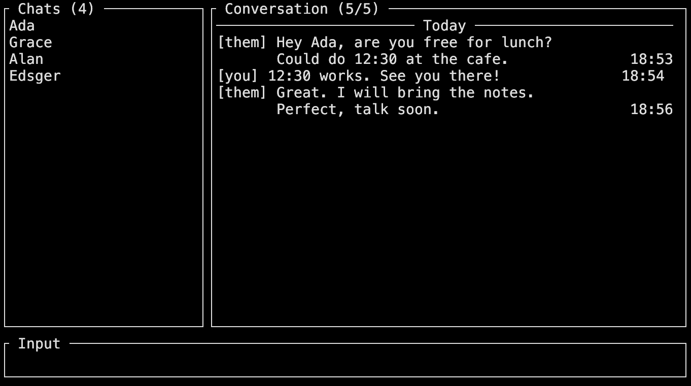

<picture>
  <source media="(prefers-color-scheme: dark)" srcset="design/logo/televim.svg">
  <source media="(prefers-color-scheme: light)" srcset="design/logo/televim-light.svg">
  
</picture>

# televim

A keyboard-driven Telegram client for the terminal, with Vim-style Normal, Insert,
and Visual modes. It runs on macOS and Linux, with an experimental Windows
build; it shows private user-to-user chats only, with no groups, channels, or bots.

Pre-1.0: see [known gaps](docs/known-gaps.md). See [memory notes](docs/memory.md) for measurement details.



*Fictional offline chats; the status row is cropped.*

## Install

Release binaries are on [GitHub Releases](https://github.com/curedbylethe/televim/releases).

| Platform | Status |
| :--- | :--- |
| macOS, Apple silicon (11.0+) | Supported |
| macOS, Intel (10.12+) | Supported |
| Linux, x86_64 (glibc 2.35+) | Supported |
| Linux, arm64 (glibc 2.35+) | Supported |
| Windows, x86_64 | Experimental |

**macOS and Linux**

```console
curl -fsSL https://raw.githubusercontent.com/curedbylethe/televim/main/scripts/install.sh | sh
```

**Windows PowerShell**

```powershell
irm https://raw.githubusercontent.com/curedbylethe/televim/main/scripts/install.ps1 | iex
```

The installer uses `$HOME/.local/bin` on macOS and Linux, or
`%LOCALAPPDATA%\televim\bin` on Windows. It offers to add the directory to
`PATH`; open a new terminal after installation. Use `--no-modify-path` or
`-NoModifyPath` to skip the `PATH` change.

Manual archives and `SHA256SUMS` are on the [release page](https://github.com/curedbylethe/televim/releases).
The checksum detects a broken download, not a compromised release; see the
[manual install and checksum steps](docs/installing.md).

On Linux, install DBus (`libdbus-1-3` on Debian or Ubuntu) and a Secret Service provider. See [platform details](docs/installing.md#linux).

## First run

<a id="credentials"></a>

Install, then start Televim:

```console
televim
```

Release binaries include Telegram application credentials, so no API setup is
needed. Sign in with your phone number and Telegram's code; enter your
two-factor password if asked. Type each value in the input bar and press
`Enter`. Both release and source builds require your Telegram login.

A source build has no application credentials. Set `TELEVIM_API_ID` and
`TELEVIM_API_HASH`, or add `api_id` and `api_hash` to `televim.toml`.

Televim reads optional `televim.toml` from the current directory. Use
`--config <path>` to select another file. Logs, drafts, history, and the account
list are stored beside it; the media cache can use a separate directory.

The login session uses the OS credential store by default. Set `session_path` to
store it in an encrypted file, and set `TELEVIM_SESSION_PASSPHRASE` or
`session_passphrase` to provide its passphrase. For keyring-free Linux setup,
see [first-run platform details](docs/installing.md#first-run).

Use `televim --chat <id>` to open a chat directly.

## Essential controls

**Anywhere**

| Key | Action |
| :--- | :--- |
| `?` / `:` | Search chats / open commands from a conversation or profile card |
| `Esc` / `Ctrl-C` | Cancel or step back / quit immediately |

**Chat list**

| Key | Action |
| :--- | :--- |
| `j` / `k` / `gg` / `G` | Move highlight; jump to first / last chat |
| `l` / `Enter` | Open chat / profile card |
| `/` / `p` | Start chat / pin or unpin the highlighted chat |

**Conversation**

| Key | Action |
| :--- | :--- |
| `j` / `k` | Previous / next message |
| `Ctrl-d` / `Ctrl-u` | Page down / up |
| `gg` / `G` | First unread / newest message |
| `i` / `a` | Write a message |
| `v` / `V` / `y` | Select text or messages; copy with `y` in Visual mode |
| `d` / `r` / `e` / `f` | Delete (confirms) / reply / edit / forward |
| `/` / `n` / `N` | Search this chat / next / previous match |
| `h` / `q` | Return to list / quit (confirms) |

**Composer**

| Key | Action |
| :--- | :--- |
| `Enter` / `Ctrl-J` | Send / insert a new line |
| `Esc` | Return to Normal mode; press again to leave the line |
| Arrow keys | Move the caret |

Type `:` in a conversation or profile card for `:chat`, `:new`, `:search`, `:attach`, `:save`, and `:q`; see the full [command list](docs/product.md#feature-set).

## Troubleshooting

- **“televim has no application credentials”**: a source build needs
  `TELEVIM_API_ID` and `TELEVIM_API_HASH`, or `api_id` and `api_hash` in config.
- **Linux keyring errors**: install your distribution's DBus runtime package
  and a Secret Service provider such as GNOME Keyring or KWallet. For headless
  use, configure `session_path` and a passphrase. See [Linux details](docs/installing.md#linux).
- **macOS blocks launch**: binaries are unsigned. If you trust the download,
  allow it in System Settings → Privacy & Security.
- **Windows warning**: Windows is experimental and the binary is unsigned; SmartScreen may warn.
- **Logs**: `televim.log` is beside the config file. Include it when reporting a
  problem in the [issue tracker](https://github.com/curedbylethe/televim/issues).

## Documentation

| Guide | Covers |
| :--- | :--- |
| [Installing](docs/installing.md) | Install, upgrade, uninstall, and platform details |
| [Product](docs/product.md) | Goals, acceptance criteria, features, and commands |
| [Known gaps](docs/known-gaps.md) | Current limitations |
| [Architecture](docs/architecture.md) | System design |
| [Decisions](docs/decisions.md) | Key project decisions |
| [Testing](docs/testing.md) | Build and verification commands |
| [Design system](DESIGN.md) | Interface design rules |
| [Changelog](CHANGELOG.md) | Release history |

<a id="building"></a>

## Building from source

Run `make build-release` for a release binary or `make run` for a debug build.
A source build needs the credentials listed above. See the [build guide](docs/testing.md).

## License

MIT OR Apache-2.0.
